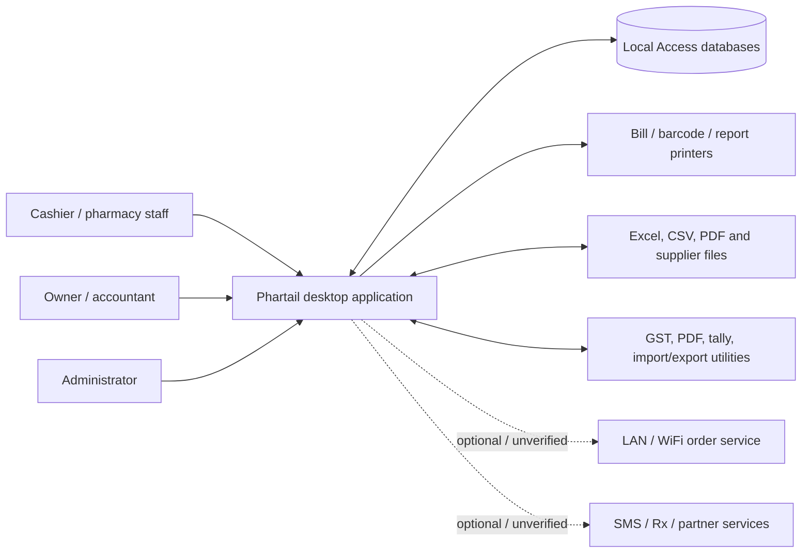
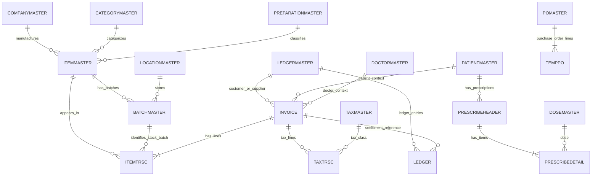

# Phartail Product and System Requirements Analysis

**Document type:** Evidence-based product analysis and provisional software requirements specification (SRS)  
**Product identified:** Phartail pharmacy billing, inventory, and business management system  
**Evidence reviewed:** `NEWSCRIPT.SQL`, `index.sql`, `datapath.INI`, `ptail_CON.txt`, report templates, setup manifest for the 2021 GST installer, and bundled feature/help documents.  
**Evidence horizon:** The bundled 2021 GST installer includes a February 2022 update document. This report does not establish the current vendor release or current regulatory status.

## 1. Executive summary

Phartail is a Windows desktop application designed to run pharmacy counter operations and related inventory, purchasing, patient, accounting, and tax work. The system is centered on a product master plus batch/location stock, sales and purchase documents, ledgers, and a large set of reports. Its configuration surface includes both database settings and filesystem switches that alter operational behavior.

The system appears to have grown incrementally from a legacy desktop product. The available installer includes Visual Basic-era components as well as .NET utilities, Access database files, spreadsheet templates, report files, DLL modules, and helper executables. Schema changes span many years and introduce new fields and menu entries through a custom SQL-like migration script. This gives the product broad domain coverage, but raises material questions about upgrade reliability, consistent business rules, data integrity, supportability, and security.

This is a **provisional SRS**, not an official vendor specification. Requirements below distinguish:

- **Observed:** Directly indicated by a filename, schema change, configuration note, report template, or installer manifest.
- **Inferred:** A likely system behavior based on linked fields or domain conventions, which should be confirmed against a running installation and vendor documentation.
- **Unknown:** Not established by the available files.

No production database records were inspected. No executable was launched. The report therefore describes the product artifacts and inferred behavior, not a runtime audit.

## 2. Product scope and actors

### 2.1 In-scope product areas

| Area | Evidence and interpretation |
|---|---|
| Pharmacy POS / counter sales | `COUNTERSALE`, `INVOICE`, `ITEMTRSC`; configuration switches refer to Counter Sales, barcode selection, discount behavior, and POS-like mall mode. |
| Inventory and batch management | `ITEMMASTER`, `BATCHMASTER`, stock reports, expiry reports, stock adjustment/transfer series, batch hold, stock logging. |
| Purchasing and supplier management | `COUNTERPURCHASE`, `POMASTER`, `TEMPPO`, supplier-item mapping, purchase bill import material, purchase-inward reports. |
| Returns / reimbursement | `reimburseheader`, `REIMBURSEDETAIL`, expiry transactions, credit-note artifacts, return amount fields. Exact return semantics need confirmation. |
| Patient and prescription workflows | `PATIENTMASTER`, patient remainder/reminder structures, prescription header/detail, doctor and dose masters, prescription report template. |
| Accounting | Ledger master, ledger transactions, account groups, bill-out, pending cash/receipts, bank reconciliation menu, day book and statements. |
| Tax and statutory reporting | VAT-era and GST-era schemas, GST registers, GST tax master/transactions, GSTR2A reconciliation, GSTR templates/tools, H1 sales report and help. |
| Connectivity and auxiliary workflows | WiFi order tables, SMS outbox and settings, e-Milan data structures, upload utilities, CSV mapper, PDF tools. Presence does not prove current service availability. |
| Reporting and exports | Many report definitions in `.txt` files, Excel templates, PDF/report files, tally export utility, CSV and upload-related components. |

### 2.2 Likely user roles

The following roles are **inferred** from access-control and workflow structures; the exact roles and privileges are unknown.

| Actor | Responsibilities |
|---|---|
| Cashier / counter operator | Find items, select batch, enter quantity, apply permitted discounts, select patient/customer if required, take payment, print bill. |
| Pharmacist / dispensing operator | Validate item and schedule restrictions, associate doctor/patient or prescription, issue products, review regulated-drug reporting. |
| Purchase / inventory operator | Enter purchase documents, import supplier bills, maintain batch/expiry/cost, manage stock corrections, returns, transfers, and reorder reports. |
| Accountant / owner | Maintain ledgers/tax mappings, reconcile receipts and bank activity, review registers, export tax/accounting data, close periods. |
| Supervisor / administrator | Manage users, permissions, configuration, printers, report settings, security overrides, and year-end operations. |
| Integration operator / external service | Receive WiFi orders or exchange product/transaction data with named external utilities or services. Scope and protocol are unknown. |

## 3. System context and deployment model

### 3.1 Deployment evidence

- The installer is titled **Phartail 2021 GST** and includes the Phartail executable, an Access database (`.mdb`) ecosystem, numerous DLL/OCX dependencies, report templates, Excel workbooks, and separate helper applications.
- `datapath.INI` includes an application path, version-like value, printer path, and an address/port (`192.168.0.101:1000`). This suggests a configurable local-network deployment, but the exact service and protocol are not documented here.
- `ptail_CON.txt` documents filesystem presence switches. Some switches enable POS behaviors, batch splitting, SMS, or overrides; other files restrict discount/rate visibility.
- The folder contains multiple versioned installations and fiscal-year databases. A production deployment may involve year-wise database files, but the precise year rollover architecture is not established.

### 3.2 High-level context diagram

Dashed connections represent optional integrations suggested by artifacts, not verified live interfaces.

## 4. Core business concepts and provisional data model

### 4.1 Entity relationship overview

The schema scripts and index definitions expose logical relationships by shared key names and indexes. The scripts do **not** establish that Access-enforced foreign keys exist. The diagram therefore shows inferred logical relationships, not confirmed constraints.

`TEMPPO` and `TEMPINVOICE` naming suggests staging/editing data, but exact lifecycle and promotion rules are unknown. `ITEMTRSC` is a generic transaction detail table indexed by invoice, item, batch, location, account, patient, doctor, salesman, and transaction type. It likely unifies multiple inventory transaction classes; that interpretation must be confirmed.

### 4.2 Table groups and likely responsibilities

| Group | Tables evidenced | Likely purpose / key relationships |
|---|---|---|
| Product/catalog masters | `ITEMMASTER`, `COMPANYMASTER`, `CATEGORYMASTER`, `PREPARATIONMASTER`, `ItemTypeMaster`, `StorageMaster`, `TITB` | Product identity, manufacturer, category, preparation/form, type, storage, and item attributes. Item fields include barcode/UPC, schedule/restricted flags, TB/COVID-era classification, discount lock, and export status. |
| Batch/stock | `BATCHMASTER`, `BATCHUPDATE`, `WIFI_BATCHUPDATE`, `logbatch`, `LOSTSALE` | Batch number, expiry, stock/cost/rates, MRP, location, tax codes, hold stock, batch hold, scratch/expiry adjustments, stock before/after logging, and lost-sale tracking. Composite index on batch item/batch/location suggests stock is location- and batch-specific. |
| Sales | `INVOICE`, `ITEMTRSC`, `COUNTERSALE`, `TEMPINVOICE`, `TEMPITEMTRSC`, `HISTORY`, `COUNTERQTY`, `COUNTERAUDIT` | Invoice header and line-level sales/stock/tax information; temporary/in-progress records; historical or audit/fast-counter support. Headers link to account, patient, doctor, salesperson, shift, and source/picked invoice fields. |
| Purchase and ordering | `POMASTER`, `TEMPPO`, `COUNTERPURCHASE`, `BILLOUT`, `BILLOUTD`, `supplierItemMaster`, `supplierItemDetail`, `MAPITEMS`, `park_invoice`, `park_detail` | Purchase orders, purchase entry, supplier bills, supplier product mapping, parked/imported invoice staging. Purchase import documentation and a CSV mapper are included. |
| Returns / reimbursement / expiry | `reimburseheader`, `REIMBURSEDETAIL`, `EXPIRYTRSC`, `temp_crnote` | Return/credit/expiry transactions, likely linked to original sale or purchase documents. The exact meanings of reimbursement and expiry transaction types are not defined by the files inspected. |
| Parties and patients | `LEDGERMASTER`, `ACCOUNTGROUP`, `PatientMaster`, `PatientDetail`, `PATIENTREMAINDER`, `DOCTORMASTER` | Supplier/customer/ledger parties, patients, patient account links, reminders/contact information, doctors. Patient fields added over time include mobile, WhatsApp, email, DOB, age, blood pressure, admission/prescription dates, and postal code. |
| Prescription / clinic | `PRESCRIBEHEADER`, `PRESCRIBEDETAIL`, `DOSEMASTER`, `DiseaseMaster`, `DiseaseDetail` | Prescription header/detail, patient/doctor linkage, medicine and dose, notes/fees, disease/preparation mapping. A prescription print template and clinic reports menu are present. |
| Tax | `TaxMaster`, `TaxGroupMaster`, `taxtrsc`, `GST_TAXMASTER`, `gst_taxtrsc`, `temp_gst_taxtrsc`, `TEMPTAXTRSC`, `GSTR2A_RECONCILE` | Tax definitions and transaction snapshots, GST component amounts/rates, input/output ledger mapping, return reconciliation against supplier/GSTR data. |
| Accounting | `LEDGER`, `LEDGERMASTER`, `ACCOUNTGROUP`, `TRAC`, `TACB`, `PendingCash`, `PendingRecPay`, `CashLess`, `daycontrol`, `runningShift` | Account structure and transaction movements, pending settlements, cash/shift control, bank and daybook reporting. Field-level posting rules are unknown. |
| Configuration / access / printing | `CONFIGURATION`, `USERMASTER`, `MENUMASTER`, `SERIESMASTER`, `CurrentNumber`, `NumMaster`, `COLORSETTINGS`, `COLORSETTINGS1`, `OWNERIMEI` | Per-user/shop settings, menu-level permissions, invoice numbering/series, printing format/style/size/printer name, access/session metadata, owner/device association. |
| Integrations | `WIFI_HEADER`, `WIFI_DETAIL`, `E_MILAN_*`, `SMS_OUTBOX`, `OWNERIMEI`, `UPLOADUPCTEMP` | Mobile/WiFi order intake, partner/product/trade data, outbound messages, device/owner associations, UPC upload/mapping. Protocols and current service availability unknown. |

### 4.3 Important fields and business identifiers

- **Item:** `itemCode` is the apparent internal item identifier; description, barcode/UPC, manufacturer/category/preparation/type/storage codes describe or classify it.
- **Batch stock key:** `BATCHMASTER` has a unique index on `(itemCode, batchNo, locationCode)`. This is strong evidence that a product may have multiple batches and that a batch stock position is tracked by location.
- **Document:** `invCode` is commonly indexed across invoice/transaction tables; `invDate`, transaction type, prefix/series, and document number fields establish document identity and reporting dimensions.
- **Party:** `accountCode` is used in ledger, sales, purchases, payment, and supplier mapping tables.
- **Patient/doctor/staff:** `patientCode`, `doctorCode`, `smanCode`, `userName`, and `shiftCode` are repeated across transactional rows for reporting and attribution.
- **Tax snapshot:** Sales/purchase/history structures carry tax rates and amounts. GST snapshots contain taxable value, IGST/CGST/SGST/cess rates and amounts, suggesting tax values may be stored on transactions rather than always recalculated from current master data.
- **Location:** `locationCode` is indexed in batches and transactions; transfer series named “From Location” and “To Location” indicate inter-location movement support.
- **State/lifecycle:** `processed`, `isprocessed`, `status`, `exported`, `picked`, and print-count fields suggest staging, integration, reconciliation, and document status tracking.

## 5. Primary workflows

### 5.1 Initial setup and configuration

1. Install Phartail and its bundled dependencies/utilities.
2. Select or configure the application/data path through `datapath.INI` or installation setup. Exact precedence and multi-database selection behavior are unknown.
3. Configure shop identity, financial year, tax, license information, default location, doctor/salesman, printer, numbering series, and user records. These fields are suggested by `CONFIGURATION`, `SERIESMASTER`, and migration history.
4. Configure menus/permissions using user and menu master data.
5. Set operational switches by adding/removing `.CON` or `.RTR` files in the expected application directory. The documented examples are listed under business logic below.
6. Import or create catalog, supplier mappings, opening balances, and stock batches.
7. Validate bill printing, barcode printing, tax setup, reports, and backup/restore before live operation.

**Requirements:** Configuration changes must be auditable and validated. The files do not establish whether configuration screens enforce this today.

### 5.2 Product and batch maintenance

1. Create or import an item and assign its product classification (manufacturer, category, preparation, type, storage, barcode/UPC, schedule/restriction flags).
2. Create a batch with batch number, expiry date, MRP, purchase/sale tax, cost/rate, location, and opening stock.
3. Optionally associate supplier-specific item codes or imported product mappings.
4. Maintain stock through purchase, sale, return, expiry, adjustment, or location transfer transactions.
5. Review near-expiry, expired, negative, below-safety, no-purchase, zero-MRP, non-moving, batch-wise, and stock-valuation reports.

**Observed controls:** unique batch identity by item/batch/location; batch hold; location; expiry fields; multiple rate bands; tax mapping; stock-change logging structures. Whether batch expiry is blocked/warned at sale is unknown.

### 5.3 Counter sale / POS

1. Start a counter sale and select the transaction series/shift and cashier/salesperson context.
2. Find items by description, barcode, or configured barcode workflow.
3. Select a batch. Batch selection likely presents stock, expiry, MRP, and cost/rate information subject to visibility restrictions.
4. Enter quantity and free quantity; optionally split a strip/batch or merge repeated product/batch lines depending on configuration.
5. Associate patient, doctor, prescription or other customer data where required by configuration or sale type.
6. Apply price and discount rules; compute tax and line totals; record payment mode, cash received, due/credit, and any additional payment mode.
7. Save/commit the invoice, update stock, create tax/accounting effects, print/export the bill, and record audit/history data.

Steps 6–7 describe expected behavior inferred from schema. Exact validation, atomicity, price calculation, posting order, and error recovery are unknown.

### 5.4 Purchase / supplier bill

1. Create a purchase order or open a supplier bill.
2. Enter/import invoice header (supplier, invoice number/date, transport, cases, payment terms) and line details (supplier item code, mapped item, batch, expiry, MRP, quantity/free quantity, rate, discounts, tax and HSN).
3. Resolve unmapped supplier items using supplier-item mapping or CSV mapping.
4. Review totals, tax, scheme/discounts, and bill-level additions/deductions/rounding.
5. Commit the purchase to stock and accounts payable; update batch balances and tax records.
6. Print/export purchase reports or reconcile the invoice with GST data.

An installer helper called `Park_Invoice.exe` and `park_invoice`/`park_detail` tables suggest invoice parking/import, including a processed flag and link to a Phartail invoice. This should be treated as a separate import/approval workflow until verified.

### 5.5 Return, expiry, and stock correction

The data model exposes sales/purchase return-like headers/details, expiry transactions, credit-note staging, and stock before/after logs. A safe operational model is:

1. Identify the source transaction and affected item/batch/location.
2. Record return/expiry reason, quantity, tax and value, and original document reference where applicable.
3. Determine whether stock is restored, quarantined, or written off based on transaction type.
4. Post the financial adjustment and update batch stock in a single consistent operation.
5. Preserve the original transaction and record a reversal/adjustment rather than silently overwriting history.
6. Report the event in return/expiry registers and the stock ledger.

Items 3–6 are recommended control requirements; the artifacts do not prove the implementation follows this pattern.

### 5.6 Prescription and patient workflow

1. Maintain a patient and optional patient ledger/account association.
2. Create prescription header with patient, doctor, date, narration/notes, fee, user, and save time.
3. Add prescribed items and dose instructions.
4. Print or select the prescription and optionally connect it to a sale.
5. Track patient reminders/follow-ups and use contact details where enabled.
6. Report patient-wise or doctor-wise sales and schedule/H1 activity.

The schema shows patient, doctor, prescription, dose, notes and patient remainder concepts. Actual reminder scheduling, consent, prescription validity checks, and controlled-drug rules are unknown.

### 5.7 Accounting and close/reconciliation

1. Post invoice/purchase/return/payment activity to ledgers.
2. Track receipts, outstanding invoices, pending cash and shift totals.
3. Reconcile bank/cheque movements and review day book/ledger statements.
4. Run sales, purchase, tax and stock registers for a selected period.
5. Reconcile purchase tax against GSTR2A data where configured.
6. Export statutory/accounting data to supported spreadsheet, PDF, CSV or Tally formats.
7. At financial year end, run year-end processing and verify opening balances in the new year.

Posting semantics, double-entry completeness, rounding policy, and year rollover behavior require runtime/vendor confirmation.

## 6. Business logic and operational switches

This section distinguishes documented switch behavior from expected policy. Switch names below are transcribed from `ptail_CON.txt` and `datapath.INI`.

### 6.1 Documented `.CON` / `.RTR` behaviors

| Switch | Documented effect | Operational risk / requirement |
|---|---|---|
| `ITMERGE.CON` | Merge same item/batch for the same salesman in Counter Sale. | Verify quantity/free quantity, discount, tax, and audit attribution remain correct after merge. |
| `GOMINUS.CON` | Allow stock to go negative when issuing full quantity; note says safety must be OFF and batch splitting will not work. | High-risk exception; require privileged enablement, explicit warning, and negative-stock report. |
| `ALWAYSBAR.CON` | Allow barcode selection popup for all transactions. | Must handle duplicate, missing, and supplier-specific barcode mappings safely. |
| `AUTOENTER.CON` | Automatically show same-salesman popup after completing a Counter Sale item. | UX shortcut; test focus/keyboard behavior and operator attribution. |
| `ADDN_ALL.CON` | Add additional information about item sold in Counter Sale. | Define field meaning, persistence, privacy, and report exposure. |
| `MALLTYPE.CON` | Adjust Counter Sale to behave like a POS terminal. | Exact differences are unspecified. |
| `MALLFULL.CON` | After scanning barcode, take full strip quantity. | Must show the quantity conversion and avoid unintended over-dispensing. |
| `COVERUP.CON` | Hide margin frame on F9 in Counter Sale. | Helps conceal cost/margin, but role-based policy should be enforced by application permissions, not only local file presence. |
| `SMS.CON` | Enable SMS mode; first line contains shop name for message text. | Secure credentials, record consent, and log message status. |
| `SMSCONFIG.DLL` | Contains SMS provider username/password/sender ID and instant/delayed flag. | Credentials embedded in local configuration are a security concern; investigate protection and rotation. |
| `CHARITY.CON` | Allow discounted sale based on configuration. | Define who can use it, discount caps, reason capture, and audit trail. |
| `GETINCITY.CON` | Select GetInCity SMS provider. | External dependency and current availability unknown. |
| `SPLITBAT.CON` | Enable issue by batch splitting. | Define stock allocation order and ensure total issued quantity is preserved. |
| `LTHEAD.CON` | Letterhead prescription printing configuration. | Template/printer compatibility requirement. |
| `SELPAT.CON` | Search-like patient selection behavior. | Patient matching must avoid selecting the wrong person with similar names. |
| `MANUORD.CON`, `EMILAN.CON` | e-Milan project switches. | External integration lifecycle unknown. |
| `SELFSELF.CON` | Barcode-based item selection for company-provided barcodes. | Keep distinct from ordinary retail barcode resolution. |
| `REMINDERSTOCK.CON` | Include balance days in stock report. | Define demand window and treatment of zero/negative sales. |
| `PRINTMOB.CON` | Print patient mobile in Sales Chart report. | Minimize personal data in printed reports. |
| `NODISC.RTR` | Disallow sale discounts except for superuser; `DISCFALL.RTR` also blocks supervisor discount. | Local switch files and role hierarchy need consistent, tamper-resistant enforcement. |
| `HIDERATE.RTR` | Hide purchase/landing values in batch popup except for supervisor; `HIDEFALL.RTR` also hides them from supervisor. | Cost confidentiality depends on trustworthy role enforcement and file permissions. |
| `OVRCHG.RTR` | Permit sale above MRP; without it the application blocks such a sale. | Exception should be justified, audited, and aligned to policy/regulations. |

`datapath.INI` documents application/data paths and a network address/port. The `.CON`/`.RTR` design implies behavior can be changed outside the application, which is convenient for legacy deployments but difficult to govern. Each switch should have a documented owner, effective scope, change log, and startup validation.

### 6.2 Expected calculation and posting logic to confirm

The following is a **proposed verification checklist**, not a claim about exact current formulas:

1. **Quantity:** Confirm saleable quantity, free quantity, strip conversion, split-batch handling, and fractional quantities; define whether free items affect taxable value.
2. **Price:** Identify rate source (MRP, retail rate, wholesale rate, customer-specific rate bands A–E, or configured margin basis). `RATE_FLAG`, rate bands, and `MARGIN_BASE` fields indicate configurable rate selection.
3. **Discount:** Define line discount versus bill discount, product scheme, cash discount, credit/debit note, discount lock, authorization thresholds, and rounding order.
4. **Tax:** Define inclusive/exclusive MRP handling, taxable base, GST component calculation, cess, TCS, tax on free items, jurisdiction/state logic, and rounding precision. Schema stores tax rates and amounts in transaction/history records.
5. **Stock:** Define when stock is reserved/decremented, how held stock is handled, whether negative balance is allowed, allocation order across batches, and treatment of expired/held batches.
6. **Returns:** Define source-document validation, return limits, tax reversal, stock restoration/quarantine, and refund/payment handling.
7. **Accounting:** Define journal entries and account mappings for sales, purchase, tax, discount, rounding, payment, returns, TCS and credit notes.
8. **Document state:** Define draft/parked/committed/cancelled/printed/exported states, number allocation, reprint counters, and reversal rules.
9. **Concurrency:** Define locking when two terminals sell or edit the same batch/customer/document and conflict recovery.
10. **Period controls:** Define date restrictions, closed period protections, year-end carry-forward, and migration recovery.

## 7. Functional requirements (provisional)

The following requirements are phrased normatively as a baseline for product verification or modernization. A tagged **[Observed]** item is supported by project artifacts; **[Inferred]** indicates expected behavior that remains to be confirmed.

### 7.1 Identity, roles, and configuration

- **FR-001 [Observed]:** The system shall maintain application users and user-specific configuration.
- **FR-002 [Observed]:** The system shall provide user/menu-level access configuration.
- **FR-003 [Inferred]:** The system shall enforce permission checks for viewing cost/margin, changing discounts, editing/cancelling sales, and invoking privileged overrides.
- **FR-004 [Observed]:** The system shall support configurable document series, numbering, printing formats, and printer assignment.
- **FR-005 [Observed]:** The system shall support data/application path configuration and local printer configuration.
- **FR-006 [Recommended]:** The system shall identify active operational switches, validate incompatible combinations, and record their changes.
- **FR-007 [Recommended]:** The system shall provide a setup checklist for tax, accounting mappings, location, licenses, backups, and printers.

### 7.2 Master data

- **FR-010 [Observed]:** The system shall maintain item, manufacturer, category, preparation, type, storage, tax, supplier, doctor, patient, ledger, location, and user data.
- **FR-011 [Observed]:** The system shall maintain product barcodes/UPCs and supplier-specific item mappings.
- **FR-012 [Observed]:** The system shall support batch data with item, batch number, expiry, location, stock, MRP, tax and rate information.
- **FR-013 [Observed]:** The system shall maintain patient contact/demographic fields and prescription/dose information.
- **FR-014 [Recommended]:** The system shall prevent duplicate or ambiguous master records and support merge/retirement with transaction history retained.
- **FR-015 [Recommended]:** The system shall validate schedule/restricted-drug attributes and required license configuration before allowing affected transactions.

### 7.3 Sales and POS

- **FR-020 [Observed]:** The system shall record sales invoice headers and item transaction details, including item, batch, location, quantity, rate/value, tax, and document context.
- **FR-021 [Observed]:** The system shall support Counter Sale, barcode selection, salesman attribution, and configurable item/batch merge behavior.
- **FR-022 [Observed]:** The system shall support patient/doctor association and invoice mobile/contact fields.
- **FR-023 [Observed]:** The system shall support discount permissions and a configurable above-MRP override.
- **FR-024 [Observed]:** The system shall support multiple payment modes and additional payment-mode configuration.
- **FR-025 [Inferred]:** A committed sale shall update stock, tax records, accounting balances, and audit/history records consistently.
- **FR-026 [Recommended]:** A sale shall not be partially committed if stock, tax, ledger, or invoice posting fails; the system shall recover or roll back consistently.
- **FR-027 [Recommended]:** A sale shall provide clear warnings for expired, held, zero/negative, or insufficient stock and identify any privileged override.
- **FR-028 [Recommended]:** Reprints, edits, cancellation, and returns shall preserve original values and record the acting user and timestamp.

### 7.4 Purchasing and inventory

- **FR-030 [Observed]:** The system shall record supplier purchase documents and item/batch details.
- **FR-031 [Observed]:** The system shall support purchase order and supplier bill import/mapping workflows.
- **FR-032 [Observed]:** The system shall support stock adjustment, batch updates, location-aware stock, and inter-location transfer series.
- **FR-033 [Observed]:** The system shall report batch-wise stock, closing stock, valuation, expiry, near-expiry, negative stock, zero MRP, below-safety, non-moving and stock-ledger data.
- **FR-034 [Inferred]:** Posting a purchase shall update stock and supplier/accounting/tax balances.
- **FR-035 [Recommended]:** Imported documents shall be staged, validated, deduplicated, reviewed, and only then committed; source file and import outcome should be retained.
- **FR-036 [Recommended]:** Stock adjustments and transfers shall record reason, source/destination, before/after balance, user, time, and reference document.

### 7.5 Prescription and patient

- **FR-040 [Observed]:** The system shall store prescription headers and prescribed medicine/dose details with patient and doctor association.
- **FR-041 [Observed]:** The system shall support prescription printing and patient/doctor-oriented reports.
- **FR-042 [Observed]:** The system shall support patient reminder/contact fields and reminder-related records.
- **FR-043 [Recommended]:** Access to patient/health fields shall be limited by role and audited.
- **FR-044 [Recommended]:** Outbound reminders shall honor consent and record delivery/failure status.

### 7.6 Tax, accounting, and reporting

- **FR-050 [Observed]:** The system shall maintain tax masters and store tax rates/amounts on transaction records.
- **FR-051 [Observed]:** The system shall support GST-oriented registers, output/input tax accounts, HSN, GST components, cess and TCS data fields.
- **FR-052 [Observed]:** The system shall support GSTR2A reconciliation data and GST spreadsheet/export tools.
- **FR-053 [Observed]:** The system shall provide sales/purchase, ledger, payment, outstanding, day-book, stock, patient, doctor, salesman, H1 and tax reports.
- **FR-054 [Observed]:** The system shall support export/printing through Excel, CSV, PDF and accounting exchange utilities found in the installer.
- **FR-055 [Recommended]:** Reports and exports shall state period, location, filters, generation time, and totals, and shall be reproducible from saved transactions.
- **FR-056 [Recommended]:** Tax exports shall be versioned by statutory schema and validated before being marked ready for submission.
- **FR-057 [Recommended]:** Financial posting shall be traceable from source document to ledger and tax register and back.

### 7.7 Integration and audit

- **FR-060 [Observed]:** The data model includes WiFi order headers/details and integration tables for e-Milan and SMS.
- **FR-061 [Inferred]:** Integration records shall be idempotently processed, with accepted/rejected/error state and source identifiers.
- **FR-062 [Recommended]:** External credentials shall not be stored as readable plaintext and shall support rotation without editing binaries.
- **FR-063 [Recommended]:** The system shall retain operational audit events for login, configuration, price/discount overrides, stock changes, imports, exports, and transaction reversals.
- **FR-064 [Observed/Concern]:** Error log artifacts include repeated “unable to connect to the remote server” upload failures; the system should display actionable status, retry safely, and expose a supportable diagnostic record.

## 8. Non-functional requirements and quality attributes

| Attribute | Provisional requirement / assessment |
|---|---|
| Data integrity | Invoice, stock, tax and ledger posting should be atomic or recoverably coordinated. There is no evidence here of transactional guarantees or database-enforced foreign keys. |
| Availability | POS should continue during normal LAN/service disruption where local operation is intended; external integration failures should not silently block core sales. Exact offline behavior unknown. |
| Performance | Barcode/item lookup and invoice posting need low-latency behavior under multiple terminals and large fiscal-year databases. No measured performance data available. |
| Security | User permissions, least privilege, protected credentials, secure network traffic, and tamper-resistant audit records are required. Current implementation unknown. |
| Privacy | Patient identifiers, contact details and health-related fields require controlled access, limited report exposure, retention rules, and consent for messaging. |
| Recoverability | Automated backups, integrity checks, restore testing, and documented year-end/database recovery are critical. No backup process is confirmed by inspected artifacts. |
| Compatibility | Installer includes legacy dependencies and old report technology; supported modern Windows versions, architecture, and update mechanism must be documented. |
| Maintainability | Repeated dated folders and a long migration script indicate an incremental legacy codebase. Schema migration should be versioned, repeatable, reversible or backed up, and observable. |
| Usability | POS should support keyboard/scanner-first operation, clear batch/expiry selection, visible totals/tax, and unambiguous confirmation. Runtime UI not reviewed. |
| Interoperability | CSV/Excel/PDF/Tally and named service integrations are evidenced, but supported schemas, retry semantics, and current endpoint support are unknown. |
| Auditability | Every financial/stock mutation should identify who, when, why, before/after state, and source document. A `logbatch` table suggests some stock-level logging but coverage is unknown. |
| Regulatory currency | Tax and regulated-drug features must be mapped to current local rules and supported update dates; historical artifacts alone cannot certify compliance. |

## 9. Data integrity and schema observations

1. **Logical links are mostly implicit.** `index.sql` defines many unique and non-unique indexes, while the migration script uses matching codes to connect records. The files inspected do not show comprehensive foreign-key constraints. If links are enforced only in application code, orphan records and inconsistent updates are possible.
2. **Document header/detail pattern is common but inconsistent.** Invoice and reimbursement data use header/detail pairs; purchases use `POMASTER`/`TEMPPO` and purchase transaction structures; parked invoices use separate headers/details. Differences in identifiers/types suggest migrations and parallel pathways accumulated over time.
3. **Historical snapshots are valuable.** Tax fields were added to `HISTORY` and transaction tables. Keeping rate/amount snapshots helps reproduce old documents after master tax rates change, provided the posting code stores consistent snapshots.
4. **Staging tables exist.** `TEMP*`, `park_*`, and `WIFI_*` tables indicate drafts, imported documents, or external transactions. Their cleanup, idempotency, and failure states need documentation.
5. **Wide configuration surface.** User configuration, menu permissions, series configuration, filesystem switches, and INI paths all affect behavior. Effective configuration may be difficult to reason about without a central report.
6. **Potentially sensitive fields.** Patient demographics, contact details, blood pressure, prescription/disease data, device identifiers, and integration credentials appear in the data model/configuration. Data minimization and access controls are important.
7. **Schema versioning needs verification.** `NEWSCRIPT.SQL` contains dated alterations and backfills, with many historical changes appearing to share one later date marker. Confirm migration order, idempotency, and compatibility with each fiscal database before upgrade.

## 10. Risks, gaps, and open questions

### Critical questions before production reliance

1. What is the currently supported release, supported Windows version, and vendor support/patch policy?
2. Is the Access `.mdb` engine used directly by all terminals? What are supported concurrent users, file-size limits, locking rules, and corruption recovery steps?
3. What are the exact posting transactions for sale, purchase, return, expiry, payment, and location transfer? Are they atomic?
4. Which tables are authoritative for current stock, sales history, tax, and ledger balances? How are the multiple transaction tables reconciled?
5. Are there actual Access relationships/constraints not represented in the SQL index scripts?
6. How do users/roles authenticate, and can local `.CON`/`.RTR` switches bypass or weaken permissions?
7. How are backups automated, stored off-device, encrypted, and restore-tested? Is year-end processing reversible?
8. What data is uploaded by Rx/WiFi/e-Milan/SMS tools, to which endpoints, under which credentials and consent model?
9. Which GST and H1 report versions are current, and how does the vendor deliver urgent regulatory changes?
10. Can all operational and patient data be exported in documented formats if the pharmacy changes system?

### Main product risks

- **Operational continuity:** local database and legacy dependency failures may interrupt billing.
- **Data integrity:** implicit relationships, staging tables, and parallel transaction tables may lead to inconsistent balances if edge cases are not handled.
- **Security/privacy:** health information and local integration credentials require stronger assurance than the artifacts provide.
- **Compliance drift:** bundled materials date to 2022; current tax or controlled-drug requirements cannot be inferred from them.
- **Configuration drift:** filesystem switches may produce undocumented differences between terminals or stores.
- **Integration reliability:** recorded upload connection failures show at least one integration path can fail; recovery and user feedback require review.
- **Support/upgrade risk:** many bundled binaries and mixed technology generations increase compatibility and patching effort.

## 11. Recommended validation plan

Use a non-production copy with synthetic data and an isolated test installation.

### 11.1 Workflow walkthroughs

- Create item, batch, supplier and tax setup; verify barcode/duplicate handling.
- Enter a supplier purchase with free quantity, discounts, multiple tax components and an unmapped item; compare document, stock, tax and ledger results.
- Sell from multiple batches; test near-expiry/expired/held stock, split batch, strip conversion, discount lock, above-MRP control, multiple payment modes, and negative-stock switch.
- Process sales return, purchase return, expiry write-off, and inter-location transfer; reconcile the stock ledger before/after.
- Create prescription, associate it with a sale, print it, and verify patient/doctor reports and access restrictions.
- Run day close, bank reconciliation, GST export, GSTR2A reconciliation, year-end and restore-from-backup procedures.

### 11.2 Data reconciliation

For every test document, compare:

- Invoice header total to sum of lines, discounts, tax and payments.
- Batch opening + receipts - issues + adjustments = closing stock by item/batch/location.
- Taxable value and tax components to tax registers and exported return data.
- Document postings to ledgers, receipts, pending balances and cash/shift totals.
- Reversal/cancellation totals to the original source and audit trail.

### 11.3 Security and resilience

- Confirm least-privilege behavior for cashier, supervisor and administrator.
- Test that local switch files cannot silently grant dangerous overrides to unauthorized users.
- Inspect credential storage and network traffic for integrations in a controlled environment.
- Interrupt network, printer, application, and machine power during a draft and during commit; verify recovery and duplicate prevention.
- Restore a backup to a clean machine and measure recovery time and data loss window.

## 12. Product improvement priorities

### P0 — Protect transactions and continuity

- Publish and test backup/restore and database integrity procedures.
- Make invoice/stock/tax/ledger posting atomic or provide deterministic repair/reconciliation tools.
- Add visible, auditable controls for negative stock, above-MRP, discount overrides, and expiry/held batch exceptions.
- Confirm current regulatory support and issue dated compatibility/update guidance.

### P1 — Reduce security and configuration risk

- Replace plaintext/local-file credentials with protected secret storage and credential rotation.
- Centralize switch/configuration management, display effective settings, and audit changes.
- Strengthen role-based patient/cost access and export controls.
- Make integration states observable, retry-safe and idempotent; surface failures in the application.

### P2 — Improve usability and interoperability

- Provide guided setup and configuration validation.
- Make import staging, mapping, validation, and rollback explicit.
- Provide documented full data export and stable integration formats.
- Improve stock/expiry exceptions and cashier workflow feedback.

### P3 — Modernize architecture

- Inventory dependencies, separate core rules from UI and report utilities, and establish automated schema/version checks.
- Move business relationships and constraints into a well-defined data layer.
- Define supported multi-store/concurrent deployment and replace fragile shared-file assumptions where needed.
- Establish a supported update channel, signed installers, and a public change log.

## 13. Requirements traceability to inspected evidence

| Evidence artifact | What it supports |
|---|---|
| `NEWSCRIPT.SQL` | Historical domain evolution: invoices, returns, prescriptions, patient fields, GST tax fields, reconciliation, batch hold, rate bands, locations, parking/import, WiFi and extra payment modes. |
| `index.sql` | Indexed identifiers and likely query/link paths, including batch item/batch/location key, invoice/date/account/patient/doctor references. Indexes do not prove referential constraints. |
| `ptail_CON.txt` | Explicit behavior of POS, barcode, discount, rate visibility, batch split, SMS, e-Milan and above-MRP filesystem switches. |
| `datapath.INI` | Local path/version/printer/network configuration clues. |
| 2021 GST `SETUP.LST` | Bundled components and the February 2022 update PDF, GST exports, PDF tools, CSV mapper, upload utilities, migration database, and legacy dependencies. |
| Report templates in `.txt` | Report coverage: stock, expiry, sales, purchase, tax, ledger, patient, doctor, schedule/H1, and reconciliation-related operations. |
| Purchase bill import and H1 help PDFs | Existence of documented purchase import and regulated-drug workflow support; detailed contents were not extractable in this environment, so their procedure details are not asserted here. |
| `ExceptionErrorLogs.TXT` | Repeated upload connection errors in the supplied log artifact; its environment and date are not established. |

## 14. Final assessment

Phartail appears to be a broad, pharmacy-focused operations product whose core design combines batch-sensitive inventory, POS billing, purchasing, patient/prescription data, accounting, and statutory reports. The product’s strongest differentiator is the depth of pharmacy-specific workflow and the breadth of its operational/reporting surface.

The biggest unresolved issues are not missing feature names; they are **assurance**: whether postings remain consistent through failures, how Access data is protected and recovered, whether current compliance updates are available, how permissions govern sensitive data and overrides, and whether integrations fail safely. Those questions should be answered through a controlled workflow/reconciliation audit and current vendor confirmation before making a migration, renewal, or compliance decision.
